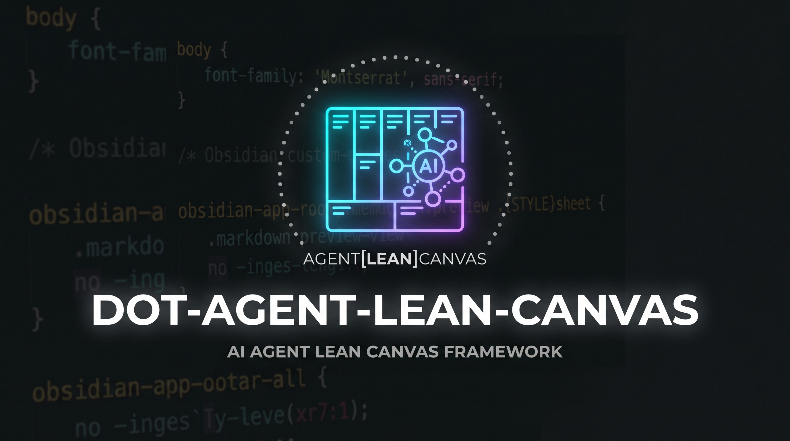
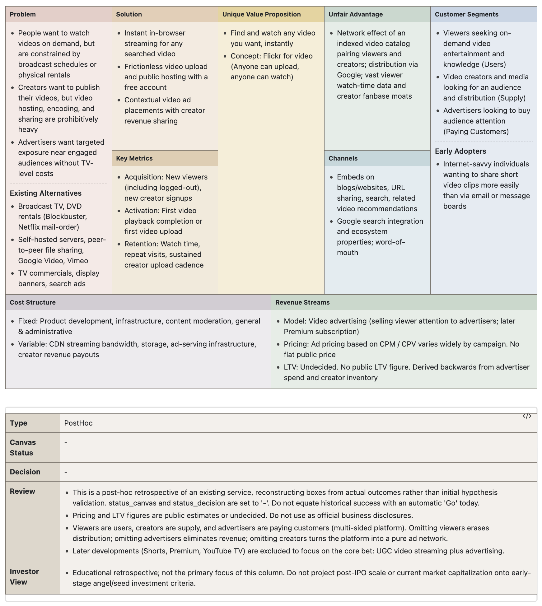

# dot-agent-lean-canvas

**English** | [日本語 (Japanese)](README_ja.md)

An AI agent skill for creating and reviewing Lean Canvases.
It treats YAML as the single source of truth and generates self-contained Markdown documents featuring HTML tables with inlined CSS styles—requiring no external CSS dependencies or special plugins.

---



> **Disclaimer**: This Lean Canvas is a retrospective case study created for educational and demonstration purposes based on publicly available information. It is not an official document, endorsement, or business disclosure by YouTube or Google LLC. All product names, logos, and brands are property of their respective owners.

---


## Key Features

- **Agent-Driven Lean Canvas Creation**:
  - Organizes hypotheses through conversational dialogue or source documents, structuring problems, customer segments, UVP, channels, revenue streams, and cost structures.
  - Decouples map completeness (`status_canvas`) from personal commitment/investment decisions (`status_decision`).
- **Dual Review Perspectives**:
  - **Personal Review (**`review_personal`**)**: Detects common logical pitfalls (solutions ahead of problems, missing alternatives, lack of early adopters, etc.).
  - **Investor View (**`review_investor`**)**: Evaluates market viability, traction hypotheses, defensibility moats, and fragile assumptions from an external venture capital perspective.
- **Portable Markdown Tables**:
  - Preserves the canonical 5-column Lean Canvas layout (Problem & Customer on outer columns, UVP in the center).
  - Inlines CSS properties directly into element `style` attributes to ensure consistent rendering across Markdown viewers like GitHub, Obsidian, VS Code, and Typora.
- **Zero External Dependencies**:
  - Runs out of the box using only the Python 3 standard library (no third-party package installation required).
- **Bilingual Support**:
  - Supports both English (`lang: en`) and Japanese (`lang: ja`) outputs and templates.

---


## Directory Structure

```text
.
├── install.sh                  # Symlink installation script for ~/.agents/skills/
├── sample_output.png           # Example Lean Canvas preview image
├── README.md                   # English documentation (this file)
├── README_ja.md                # Japanese documentation
├── LICENSE                     # CC BY-NC 4.0 License
└── skills/
    └── docs-lean-canvas/
        ├── SKILL.md            # Agent skill instructions
        ├── assets/
        │   ├── template.yaml   # Lean Canvas YAML schema & template
        │   ├── template.md     # Table HTML skeleton (Japanese)
        │   ├── template_en.md  # Table HTML skeleton (English)
        │   └── lean-canvas.css # CSS styling (inlined into Markdown during generation)
        ├── references/
        │   ├── review-investor.md  # Investor review guidelines & criteria
        │   └── sample/         # Retrospective case studies (Mercari, OpenAI, LinkedIn, YouTube)
        ├── scripts/
        │   ├── render.py       # YAML -> Markdown table renderer
        │   └── inline_css.py   # Zero-dependency CSS inliner
        └── tests/
            ├── test_render.py  # Unit tests for rendering, escaping, and cascades
            └── test_layout_browser.py # Optional browser visual regression tests via Playwright
```

---


## Installation

`install.sh` assumes macOS / Linux. On Windows, run it under WSL.

Symlink the skill from this repository into `~/.agents/skills/docs-lean-canvas`:

```bash
# Preview actions without modifying anything (dry-run)
./install.sh --dry-run

# Run installation
./install.sh
```

> **Note**: `install.sh` installs the skill under `~/.agents/skills/`. Cursor and Codex load skills from this directory directly, so no extra setup is needed for them. If your agent loads skills from a different directory, either change the destination to match your environment or create a symlink from that directory. For example:
>
> ```bash
> # Claude Code (~/.claude/skills/)
> mkdir -p ~/.claude/skills
> ln -s ~/.agents/skills/docs-lean-canvas ~/.claude/skills/docs-lean-canvas
>
> # Antigravity / Antigravity IDE / Antigravity CLI (~/.gemini/config/skills/)
> mkdir -p ~/.gemini/config/skills
> ln -s ~/.agents/skills/docs-lean-canvas ~/.gemini/config/skills/docs-lean-canvas
> ```

---


## Usage


### 1. Using with AI Agents (Cursor, Antigravity, etc.)

Prompt your AI agent:

> "I have an idea for [product/service name]. Help me create a Lean Canvas."

In agents that support it, you can also invoke the skill explicitly with a slash command such as `/docs-lean-canvas` (the invocation syntax varies by agent).

The agent follows `skills/docs-lean-canvas/SKILL.md` to interactively build `{slug}.lean-canvas.yaml`, and automatically executes `render.py` to output `{slug}.lean-canvas.md`.

#### Output Directory Configuration

- **Explicit Prompt Priority**: If a path is specified in your prompt (e.g., `Save to docs/ideas/`), that destination is always prioritized.
- **Environment Variable (**`LEAN_CANVAS_OUTPUT_DIR`**)**: If you prefer saving all canvases in a fixed location (e.g. inside an Obsidian vault), set the environment variable:
  ```bash
  export LEAN_CANVAS_OUTPUT_DIR="$HOME/ObsidianVault/business/idea"
  ```
- **Interactive Prompt**: If neither is set, the agent will ask you where to save the files (defaulting to the current working directory).


### 2. Manual CLI Markdown Generation

You can also run the renderer script directly from the command line:

```bash
# Basic usage (outputs .md alongside the YAML file)
python3 skills/docs-lean-canvas/scripts/render.py path/to/my-product.lean-canvas.yaml

# Specify custom output path
python3 skills/docs-lean-canvas/scripts/render.py path/to/my-product.lean-canvas.yaml path/to/output.md

# Force English template & labels
python3 skills/docs-lean-canvas/scripts/render.py path/to/my-product.lean-canvas.yaml --lang en
```

---


## Running Tests

Run the test suite using Python's built-in `unittest`:

```bash
PYTHONDONTWRITEBYTECODE=1 python3 -m unittest discover -s skills/docs-lean-canvas/tests -v
```

---


## License

This project is licensed under the [Creative Commons Attribution-NonCommercial 4.0 International (CC BY-NC 4.0)](LICENSE) license.
You are free to share and adapt the material for non-commercial purposes with appropriate credit, but commercial use is prohibited.